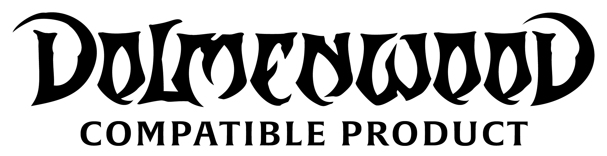
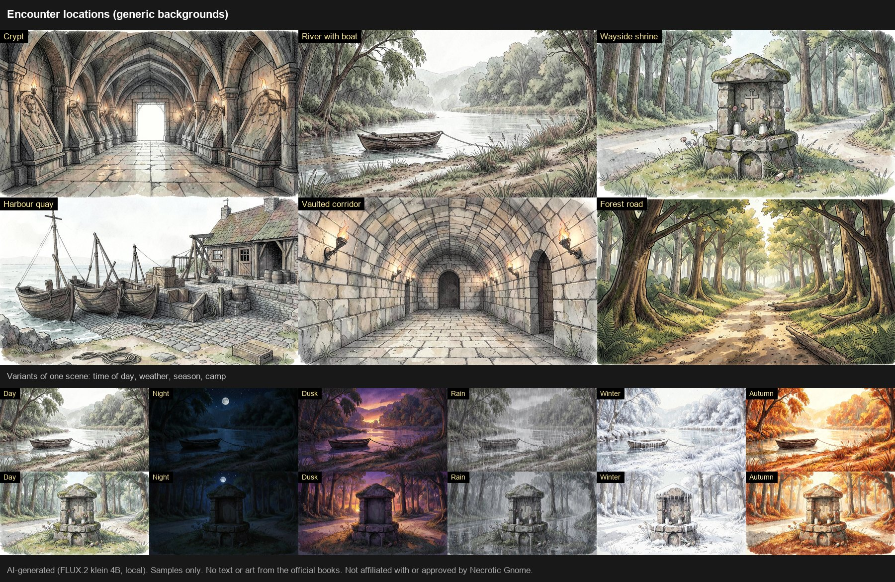
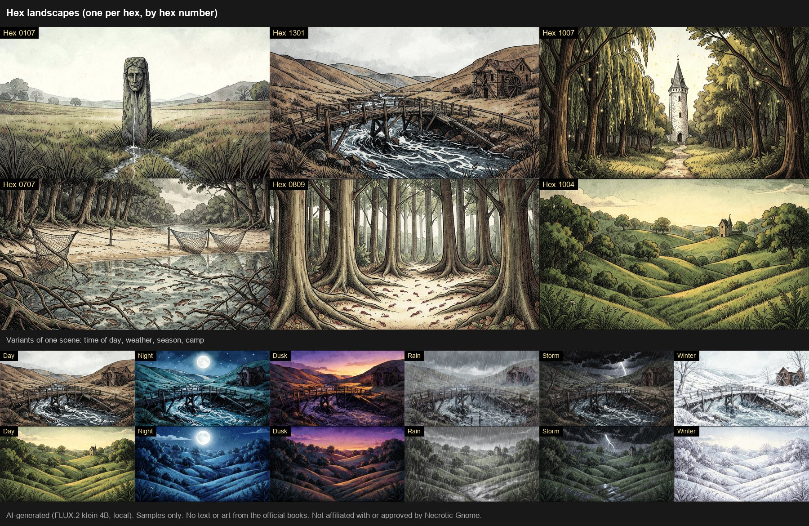

# Hexcrawl Backdrops



*Szenen für das Dolmenwood-Rollenspiel.* [English instructions: README.md](README.md)

Hintergründe für Hexcrawls in Foundry VTT. Jede Szene hat Varianten für Tageszeit, Wetter, Jahreszeit und Lager, die du von Hand umschaltest.

- **159 Begegnungsorte**: Wald, Moor und Wasser, Siedlungen, Gasthäuser und Innenräume, Dungeons und Lagerplätze
- **200 Hex-Szenen**: eine Landschaft je Hexfeld, nummeriert von `0101` bis `1906`
- **20 Feen-Szenen**: die sechs Feenstraßen und die vierzehn Feenreiche
- **Varianten**: Nacht, Dämmerung, Regen und Nebel, Gewitter, leichter Nebel, Winter, Herbst, Frühling sowie Lager am Abend und bei Nacht (Innenräume: Nacht, Sturmnacht, Morgen)
- **Sprachen**: Szenen- und Ordnernamen auf Deutsch oder Englisch, gewählt beim Import.

Es ändert Wetter, Zeit oder Effekte nicht von selbst: Du wählst die Variante.

## Warum es das gibt
Ich habe diese Szenen für meine eigene Dolmenwood-Kampagne gemacht. Vielleicht helfen sie auch anderen Spielleitern, deshalb teile ich sie kostenlos. Einige der KI-Bilder sind nicht perfekt. Damit muss man leben: Passt ein Bild nicht, nimmt man einfach ein anderes. Es geht um eine gute Auswahl an Hintergründen, nicht um Perfektionismus.

## KI-Hinweis: So sind die Bilder entstanden
**Alle Bilder in diesem Modul sind KI-generiert.** Ich habe jedes Bild lokal auf meinem eigenen Computer mit FLUX.2 klein 4B (Black Forest Labs, Apache 2.0) erzeugt, anhand meiner eigenen schriftlichen Szenenbeschreibungen. Ich habe die Bilder ausgewählt und geprüft und, wenn eines nicht zum Ort passte, neu erzeugt oder bearbeitet. Ich habe keine offiziellen Dolmenwood-Bilder, -Karten oder -Texte als Eingabe oder Vorlage benutzt, und kein Modell wurde mit Dolmenwood-Material trainiert oder nachtrainiert. Das Modul enthält keine Musik und keine Texte aus den Büchern. Einzelheiten: LICENSE-IMAGES.md.

## Vorschau
Einige Szenen mit ihren Varianten (Nacht, Dämmerung, Regen, Gewitter, Winter, Herbst):





## Voraussetzungen
- Foundry VTT v14
- Die Dolmenwood-Grundbücher
- Empfohlen: **Alternate Zone Movement** (Bewegungszonen in den Begegnungsorten)

## Installation
In Foundry: *Add-on-Module, Modul installieren*, die Manifest-URL unten in das Feld einfügen:

```
https://github.com/Angband666/hexcrawl-backdrops/releases/latest/download/module.json
```

Der Download ist etwa 870 MB groß. Das Modul in der Welt aktivieren.

## Erster Start
Öffnet ein GM eine Welt zum ersten Mal mit dem Modul, erscheint ein Dialog. **English** oder **Deutsch** wählen, dazu die gewünschten Pakete, dann *Importieren*. Die Szenen entstehen im Ordner *Hexcrawl Backdrops*. Den Dialog kannst du jederzeit wieder öffnen: *Einstellungen, Einstellungen konfigurieren, Hexcrawl Backdrops, Szenen importieren…*

- *Importieren* legt fehlende Szenen an und überspringt vorhandene. Du kannst es gefahrlos wiederholen.
- *Aktualisieren und umbenennen* verknüpft die Varianten bereits importierter Szenen neu und benennt Szenen und Ordner in die gewählte Sprache um. Eigene Änderungen an den Szenen bleiben erhalten.
- Die Bilder bleiben im Modulordner, sie werden nicht in deine Welt kopiert.

## Variante umschalten
Öffne eine Szene des Moduls und wähle eine Variante:

- **Makro** *Bildvariante…* (wird automatisch auf deine Makroleiste gelegt): eine Liste aller Varianten der Szene.
- **Schnellmakros** im Makro-Ordner *Hexcrawl Backdrops / Bild*: *Tag, Nacht, Dämmerung, Regen & Nebel, Gewitter, Leichter Nebel, Winter, Herbst, Frühling, Sturmnacht, Morgen, Lager am Abend, Lager bei Nacht*. Zieh die, die du brauchst, auf die Leiste.
- **Chat-Befehl** (nur GM):

```
/backdrop                 öffnet die Liste für die aktuelle Szene
/backdrop nacht           zeigt direkt eine Variante: tag, nacht, dämmerung, regen, gewitter, nebel, winter, herbst, frühling, lager, lagerabend
/backdrop import          öffnet den Import-Dialog
/backdrop macros          legt fehlende Makros an und benennt vorhandene in die gewählte Sprache um
/backdrop help            listet die Namen auf
```

`/hcb` funktioniert als Kurzform. Das Lagerfeuerlicht erscheint nur in den Lager-Varianten. Nicht jede Szene hat jede Variante (Innenräume haben Nacht, Sturmnacht und Morgen; Dungeons nur das Lager bei Nacht); fehlt eine Variante, erscheint eine Meldung.

## Einstellungen
- Sprache der Szenennamen
- Knopf *Szenen importieren…*

## Hinweise
- Hex-Szenen heißen nur nach ihrer Hex-Nummer.
- Die Feen-Szenen tragen die Namen der Feenstraßen und Feenreiche.
- Die Szenen entstehen in der Größe ihres Bildes. Spielfiguren funktionieren wie auf jeder anderen Szene.
- Ältere Testversionen haben Wetter-Makros angelegt; sie werden automatisch entfernt.

## Urheber und rechtliche Hinweise
Code: MIT, siehe LICENSE. Bilder: CC BY-NC 4.0, siehe LICENSE-IMAGES.md. Erstellt mit FLUX.2 klein 4B.

Dolmenwood wird von Necrotic Gnome veröffentlicht: https://necroticgnome.com

This is an independent product published under the Dolmenwood Third-Party Licence and is not affiliated with or approved by Necrotic Gnome. Dolmenwood® and all related characters and elements are © Necrotic Gnome and used with permission under licence. Requires the Dolmenwood core books.

Dolmenwood-Compatible-Product-Logo: siehe NOTICE.md.
