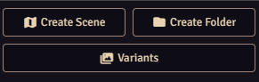
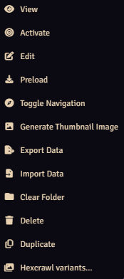
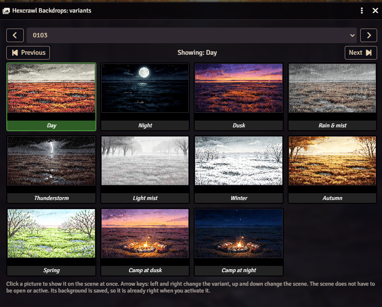

# Hexcrawl Backdrops


*Scenes for the Dolmenwood RPG.* [Deutsche Anleitung: README.de.md](README.de.md)

> ☕ **This module is and stays free.** If it helps your game and you feel like it, you can <a href="https://buymeacoffee.com/angband"></a>. That is entirely voluntary and nothing in the module depends on it.

Backdrops for hexcrawl play in Foundry VTT. Every scene comes with variants for time of day, weather, season and campsite, which you switch by hand. It does not change weather, time or effects by itself.

- **159 encounter places**: forest, bog and water, settlements, inns and interiors, dungeons and campsites
- **200 hex scenes**: one landscape for each hex, numbered `0101` to `1906`
- **20 fairy scenes**: the six fairy roads and the fourteen fairy realms
- **Variants**: night, dusk, rain and mist, thunderstorm, light mist, winter, autumn, spring, and campsites at dusk and at night (interiors: night, stormy night, morning)
- **Languages**: scene and folder names in English or German, chosen when you import.

## Installation
**Requirements:** Foundry VTT v14 and the Dolmenwood core books. Optional: **Alternate Zone Movement**. The encounter places contain movement zones that this module supports. You do **not** need it to use the scenes: without it they work as ordinary backdrops, and with it tokens move from zone to zone in the encounter places.

In Foundry: *Add-on Modules, Install Module*, paste the manifest URL into the field at the bottom, install (about 880 MB) and enable the module in your world:

```
https://github.com/Angband666/hexcrawl-backdrops/releases/latest/download/module.json
```

## How to use
### 1. Import the scenes
When a GM opens a world with the module for the first time, a dialog appears. Choose **English** or **Deutsch** and the packs you want, then press *Import*. The scenes are created in the folder *Hexcrawl Backdrops*; the images stay in the module folder. You can open the dialog again at any time: *Settings, Configure Settings, Hexcrawl Backdrops, Import scenes…*

- *Import* creates missing scenes and skips existing ones, so you can run it again safely.
- *Update and rename* re-links the variants of imported scenes and renames scenes and folders to the chosen language. Your own changes to the scenes are kept.

### 2. Switch the variant
Open the **Scenes** list on the right, right-click any Hexcrawl scene and choose **Hexcrawl variants**, or press the **Variants** button above the list. In the window that opens, click a picture and the scene changes at once. The arrow keys step through the variants (left, right) and the scenes (up, down).

The scene does not have to be open or active. Choose the variant first, activate the scene later, and your players see the right picture right away.






More ways:
- **Macro** *Backdrop variant…* opens the same window. It is put on your hotbar when you import (if the bar is full, it is in the macro folder *Hexcrawl Backdrops*). The folder *Hexcrawl Backdrops / Backdrop* also holds quick macros for *Next variant*, *Previous variant* and every single variant. Drag the ones you use to the hotbar.
- **Chat commands** (GM only; `/hcb` works as a short form):

```
/backdrop                 opens the variant window for the current scene
/backdrop next            next variant (also: /backdrop prev)
/backdrop night           shows a variant directly: day, night, dusk, rain, storm, mist, winter, autumn, spring, camp, campdusk
/backdrop import          opens the import dialog
/backdrop macros          creates missing macros and renames existing ones to the chosen language
/backdrop help            lists the names
```

The campfire light appears only in the campsite variants. Not every scene has every variant (interiors have night, stormy night and morning; dungeons only the camp at night); you get a message if a variant is missing.

## Preview
A few scenes and their variants (night, dusk, rain, storm, winter, autumn):


## Why this exists
I made these scenes for my own Dolmenwood campaign. Other game masters may find them useful, so I share them for free. Some of the AI images are not perfect. That is part of the deal: if one does not work for you, just pick a different one. This is about a good selection of backdrops, not about perfection. This is my first release on GitHub, so please be patient with me. I simply hope it will be useful for other game masters.

## AI disclosure: how the images were made
**All images in this module are AI-generated.** I made every image locally on my own computer with FLUX.2 klein 4B (Black Forest Labs, Apache 2.0), from my own written scene descriptions. I picked and checked the images and regenerated or edited them where they did not fit the place. I used no official Dolmenwood artwork, maps or text as input or reference, and no model was trained or fine-tuned on Dolmenwood material. The module contains no music and no text from the books. Details: LICENSE-IMAGES.md.

## Notes
- Settings: the language of the scene names and the *Import scenes…* button.
- Hex scenes are named by hex number only. Fairy scenes carry the names of the fairy roads and realms.
- The scenes are created at the size of their image. Tokens work as on any other scene.

## Credits and legal
Code: MIT, see LICENSE. Images: CC BY-NC 4.0, see LICENSE-IMAGES.md. Made with FLUX.2 klein 4B.

Dolmenwood is published by Necrotic Gnome: https://necroticgnome.com

This is an independent product published under the Dolmenwood Third-Party Licence and is not affiliated with or approved by Necrotic Gnome. Dolmenwood® and all related characters and elements are © Necrotic Gnome and used with permission under licence. Requires the Dolmenwood core books.

Dolmenwood Compatible Product logo: see NOTICE.md.
